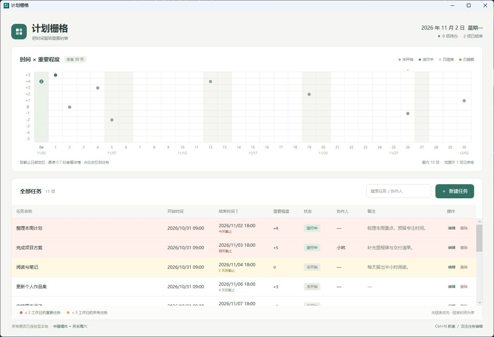

# CyberSecretray::Working

一个简约的个人计划管理工具。上方用时间与重要程度组成栅格，下方用表格管理任务。

Windows 桌面应用，下载 EXE 即可运行，免安装，无需另外安装 .NET。

[下载 v0.2.1](https://github.com/fanqin-zeng/cyber-secretary-working/releases/tag/v0.2.1) · [使用说明](使用说明.txt) · [MIT 协议](LICENSE)



## 快速开始

1. 在 [Releases](https://github.com/fanqin-zeng/cyber-secretary-working/releases) 下载 `CyberSecretray-Working-v0.2.1-win-x64.zip`。
2. 解压后双击 `CyberSecretray-Working.exe`。也可下载单独的 `CyberSecretray-Working-v0.2.1-win-x64.exe` 直接运行。
3. 点击表格右上角的「新建任务」，填写任务信息。

支持 Windows 10 / Windows 11 x64。核心功能离线可用，不需要管理员权限。首次启动为空任务列表，截图中的任务仅用于演示。

## 任务信息

| 字段 | 必填 | 规则 |
| --- | --- | --- |
| 任务名称 | 是 | 最多 120 个字符 |
| 开始时间 | 是 | 日期 + 24 小时制时刻，精确到分钟 |
| 结束时间 | 是 | 不能早于开始时间 |
| 重要程度 | 是 | -5 至 +5 的整数，≥ +1 为重要任务 |
| 状态 | 是 | 未开始、进行中、已结束、已超期 |
| 备注 | 否 | 支持多行文字 |
| 协作人 | 否 | 多人可用逗号或顿号分隔 |

未结束任务在截止时刻过去后自动转为「已超期」，已结束任务不会被覆盖。应用每 15 秒检查一次，跨天更新日期与提醒。

## 两个视图

### 时间栅格

- 横轴：从今天起，右端为「今天后 30 天」与「最远任务结束日期」中的较晚者，一次显示 31 列。
- 鼠标在栅格上时，上下滚轮或横向滚轮均可横向浏览。点击栅格后也可使用左右方向键；Home 回到今天，End 到达最远端。
- 纵轴：重要程度 -5 至 +5，共 11 行。
- 任务按「结束日期 × 重要程度」定位，点的样式表示状态。
- 同一格有多个任务时显示数量，避免重叠遮挡。
- 悬停 0.7 秒显示任务详情；点击定位表格；双击单任务点可编辑。
- 远期任务可通过横向浏览查看；截止日期已过去的任务仍保留在表格中。

### 任务表格

- 未结束任务在前，已结束任务在后；两组内均按结束时间升序排列。
- 支持新建、编辑、删除，以及按任务名、备注、协作人搜索。
- 表格筛选不影响栅格，栅格始终显示完整任务范围。
- `Ctrl+N` 新建任务，双击表格任务可编辑，编辑时 `Ctrl+Enter` 保存。

## 工作日：采用「华为风格」

**本项目使用「华为风格」的自定义工作日计算。** 这里的名称指下面这组固定规则：

1. 以中国国务院公布的法定节假日和调休安排为基础。
2. 每月最后一个周六额外算作工作日，即「月末周六」。
3. 如果这个周六本来就是调休工作日，只计算一次；该月不再增加其他「月末周六」，也不顺延或提前补一天。
4. 当前实现中，月末最后一个周六即使落在法定假期内，也按这条额外规则计入。

例如，2026 年 2 月 28 日既是最后一个周六，也是法定调休工作日，只计一次，不会把 2 月 21 日补成工作日。2026 年 11 月 28 日则作为额外的「月末周六」计入。

### 截止提醒

从今天开始计数；今天是工作日时记为第 1 个工作日，休息日不增加工作日数量。

| 背景色 | 条件 |
| --- | --- |
| 浅灰色 | 已结束任务，优先于其他颜色规则 |
| 红色 | 未结束、重要程度 ≥ +1，且截止日在含今天的前 2 个工作日范围内 |
| 黄色 | 截止日在第 5 个工作日之前的其余未结束任务 |
| 默认 | 不满足上述条件 |

已结束任务统一浅灰色，不参与截止提醒。未结束任务红色优先于黄色；已过截止日的未结束任务延续提醒，重要任务红色，其余黄色。截止日在休息日时，计算今天至该截止日期之间的工作日数量，最小记为 1。

以 2026/11/02（周一）的未结束任务为例：

- 11/02、11/03 截止的重要任务标红。
- 11/02 至 11/05 截止的其他任务标黄。
- 11/06 是第 5 个工作日，不满足「< 5 工作日」，不标黄。

### 年度日历

已内置 2025、2026 年日历。点击底部「工作日规则」可查看规则、更新或导入年度 JSON 日历。

尚未收录的年度会显示「法定日历待补全」，不猜测调休，不据此错误着色。空的未公布日历文件不会被视为完整日历。只有手动点击更新时才会联网获取日历，不上传个人任务。

日历数据来自 [NateScarlet/holiday-cn](https://github.com/NateScarlet/holiday-cn)，依据国务院年度通知。2026 年安排见 [中国政府网](https://www.gov.cn/zhengce/content/202511/content_7047090.htm)。

## 本地数据与备份

```text
%LOCALAPPDATA%\CyberSecretary\
├── tasks.json       # 当前任务
├── tasks.json.bak   # 上一次保存的任务备份
└── calendars\       # 更新或导入的年度日历
```

更换 EXE 不会删除任务。换电脑或手动备份时，先退出应用，再复制任务文件和 `calendars` 文件夹。

保存采用原子替换。主文件损坏且备份有效时，会保留损坏原文件并恢复备份；没有有效备份时提示错误，不会用空列表覆盖原文件。同一数据目录只允许一个实例运行。

## 从源码构建

需要 Windows 和 [.NET 10 SDK](https://dotnet.microsoft.com/download/dotnet/10.0)。普通用户运行已发布的 EXE 不需要 SDK。

```powershell
git clone https://github.com/fanqin-zeng/cyber-secretary-working.git
cd cyber-secretary-working
powershell -NoProfile -ExecutionPolicy Bypass -File .\build.ps1
```

脚本依次执行规则与存储检查、WPF 界面集成检查，并发布自包含的单文件 EXE 至 `release/CyberSecretray-Working.exe`。

应用共有 79 项检查：43 项规则与存储检查、36 项界面集成检查。发布流程还会检查版本 tag、附件校验值与 EXE 中的版本号。测试使用独立临时目录，不写入个人任务。

```powershell
# 生成带版本号的 ZIP、EXE 和 SHA256 校验文件
powershell -NoProfile -ExecutionPolicy Bypass -File .\package.ps1

# 使用独立目录启动演示，避免混入个人任务
.\release\CyberSecretray-Working.exe --demo --data-dir "D:\PlannerDemo"
```

`--demo` 仅在指定目录尚无任务文件时生成示例任务；正常双击不会生成示例。

```text
src/CyberSecretary/       WPF 界面与交互
src/CyberSecretary.Core/  任务规则、工作日与 JSON 存储
tests/                   规则、存储及界面集成检查
docs/                    界面预览
notices/                 随运行时分发的许可文本
build.ps1                检查与构建
package.ps1              版本化打包
scripts/                 发布版本号解析
.github/workflows/       Windows 构建与 Release 发布
```

## 自动发布 Release

推送 `v` 开头的版本 tag 后，[GitHub Actions](https://github.com/fanqin-zeng/cyber-secretary-working/actions/workflows/release.yml) 会自动完成：

1. 在 Windows runner 安装 .NET 10，检查版本 tag，并执行规则、存储与 WPF 界面检查。
2. 根据 tag 写入程序版本，构建 Windows x64 自包含单文件 EXE，生成完整 ZIP 和 `SHA256SUMS.txt`。
3. 校验附件及程序版本，再发布到同名 Release；Release 不存在时自动创建。

```powershell
# 将后续提交发布为 v0.3
git tag -a v0.3 -m "Release v0.3"
git push origin v0.3
```

tag 支持 `v0.2`、`v0.2.1`、`v1.0.0-rc.1`，分别对应程序版本 `0.2.0`、`0.2.1`、`1.0.0-rc.1`；附件名称完整保留 tag。带预发布后缀的版本会标记为 GitHub Pre-release。无需为了发布而先修改 `Directory.Build.props`。

同名 Release 已存在时保留其标题和说明，并上传或替换同名附件。新 Release 先创建为草稿，附件上传成功后才正式发布。若执行失败，可在 Actions 中重跑。

流程使用自动提供的 `GITHUB_TOKEN`，无需另配 PAT 或仓库 Secret。构建任务只有读取权限，发布任务才获得 `contents: write`。

也可在 Actions 页面点击 **Run workflow**，手动验证构建；手动运行仅保留构建产物 14 天，不发布 Release。

本地可指定相同 tag 打包：

```powershell
powershell -NoProfile -ExecutionPolicy Bypass -File .\package.ps1 -Tag v0.2.1
```

## 开源协议

项目采用 [MIT License](LICENSE)，允许使用、修改、商业使用与再分发，分发时保留版权和许可声明。

日历数据保留其原始 MIT 许可；自包含版本所用 .NET / WPF 及其第三方组件的许可说明见 [THIRD_PARTY_NOTICES.md](THIRD_PARTY_NOTICES.md)。
